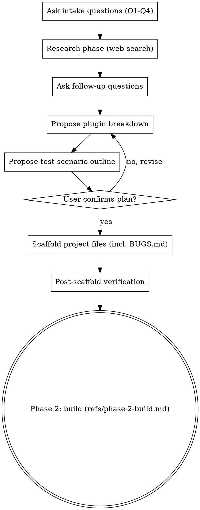

# Phase 1 — Brainstorm and Scaffold

You research offline installation approaches via web search, break the project into plugins, plan every parameter and a minimal test scenario, and scaffold local project files under `{ROGUE_WORKSPACE}/plugin-dev/`. You do NOT write the real Ansible implementation here — that's phase 2; this phase only scaffolds a deploy-safe no-op placeholder task.

## Where This Phase Sits In The Cycle

Scaffolding a clean project does NOT mean the work is close to done. Once phase 2 starts, the real shape is the deploy-debug-fix cycle in SKILL.md. Set the user's expectation accordingly: this phase gets the plan, the parameters, and the test scenario right *before* the cycle begins, so the build phases have stable ground to iterate on. A complete, accurate plan up front matters because every redeploy is canvas-wide and expensive, and because every plugin and every declared param has to exist on the platform before the canvas can use it.

## Red Flags — Stop If You Catch Yourself Thinking This

| Thought | Reality |
|---------|---------|
| "The user said 'install X' — I know how, skip the research phase" | You don't know the OFFLINE install path. Web search first. Every tool has download/mirror quirks you haven't seen. |
| "This is straightforward, one plugin is fine" | Straightforward on an internet-connected box. Offline installs routinely split into 2-3 plugins (download, configure, validate). Propose the split and let the user collapse it. |
| "Success criteria: 'it installs correctly'" | That is not a success criterion. What port? What service? What command returns what output? Push back until Q3 is concrete. |
| "I'll figure out the download script details during the build phase" | The download list is a phase 1 deliverable. If you can't name the files now, you haven't finished research. |
| "The user said no quirks, so Q4 is done" | Acceptable — but cross-check against your research. If you found quirks the user didn't mention, surface them. |

## Checklist

The router already read the Ansible KB and resolved the workspace. You MUST create a task for each of these items and complete them in order:

1. **Ask intake questions** (Q1-Q4) one at a time
2. **Research phase** — heavy web searching to figure out the offline install approach
3. **Back-and-forth** — ask follow-up questions as research reveals unknowns
4. **Plugin breakdown** — propose single vs multi-plugin structure, with every parameter
5. **Test scenario outline** — propose a minimal canvas (domain/VLAN/machine/plugin loadout) needed to exercise these plugins; cross-check required platform plugins exist in the catalog
6. **Confirm full plan** with the user (plugins + test scenario) — the binding gate
7. **Scaffold** project folder and all files (incl. `BUGS.md`)
8. **Post-scaffold verification**
9. **Move to phase 2** — load `refs/phase-2-build.md`

## Process Flow



---

## Intake Questions

Ask these questions **one at a time**. Do not batch them. Wait for the user's response before moving to the next question.

### Q1 — What are you building?

"Describe the overall project. What software or service needs to be installed and configured?"

Open-ended. Understand the full picture — what the end result looks like, what machines are involved. Ask clarifying follow-ups if the description is vague.

### Q2 — What OS(es) does it target?

Multiple choice: `Linux` | `Windows` | `Both`

If "both," this likely means multiple plugins (one per OS target).

### Q3 — What does "done" look like?

"When the plugin runs successfully, what should be true? What can we check to verify it worked?"

Concrete success criteria — e.g., "WireGuard service is running, peers can ping each other" or "BloodHound CE web UI is accessible on port 8080."

**If the answer is vague** (e.g., "it just works", "it installs fine", "should be obvious"), push back: "I need at least one checkable assertion — a running service, a listening port, a CLI command that returns expected output. What specifically can we verify?" Do not proceed to Q4 until Q3 yields a testable criterion.

### Q4 — Any known install quirks?

"Any known issues, offline gotchas, prerequisites, or special requirements I should know about?"

Open-ended, optional — user can skip. Things like: "the MSI needs a /qn flag," "requires .NET 4.8 first," "Docker images need to be pre-pulled."

**Stay focused on install-time quirks.** The final deploy state is always fully offline (resources baked into the plugin vault) — that's a given, not a question. Ask about silent flags, version pinning, prerequisites, dependency ordering, reboot needs. Don't ask the user whether the target is air-gapped.

---

## Research Phase

After intake, use **WebSearch extensively** to determine:

- **How to install/configure the thing** — official docs, community guides, blog posts
- **Offline installation approach** — what needs to be downloaded ahead of time
- **What apt packages are needed** — these go directly in the Ansible YAML via the local apt mirror (see KB: Apt Mirror Pattern for URL and repo path conventions)
- **What must be downloaded separately** — installers, Git repos, Docker images, Chocolatey packages (these go in the download script)
- **Known gotchas** — silent install flags, service dependencies, required reboots, version compatibility issues

Ask the user follow-up questions as research reveals unknowns. Don't guess — if something is unclear, ask.

---

## Plugin Breakdown

Based on research, propose whether this is a **single-plugin** or **multi-plugin** project.

For each plugin, specify:
- **Name** (kebab-case, e.g., `wireguard-server`)
- **Display Name** — human-readable name shown in the UI (e.g., "WireGuard Server")
- **Description** — what the plugin does, **max 600 characters** (platform limit). Write this for the user who will be selecting plugins in the UI — it should clearly explain what gets installed/configured and what the end result is.
- **Target OS** (`linux` or `windows`)
- **Plugin Type** — one of: `action`, `role`, `application`, `vulnerability`, `attack`, `defense`. Propose a type based on intent (see Plugin Type Selection below); user can override.
- **What it installs/configures** (one sentence)
- **What files need downloading** (what goes in the download script)
- **Dependencies** on other plugins in this project (if any)
- **Parameters** — list every user-configurable value. For each parameter:
  - **name** — camelCase identifier used in `{{ }}` Jinja2 references (e.g., `Hostname`, `DomainNameFQDN`)
  - **type** — one of: `string`, `number`, `boolean`, `stringBlock`, `csv`
  - **required** — `true` or `false`
  - **description** — what this parameter controls, written for the end user. **For `csv`-type params, the description MUST embed a copy-paste-ready example as a fenced block** (headers + 4-10 realistic rows). End users see this description in the platform UI; embedding the example lets them copy, paste, and edit. Format like:
    ```
    OUs to create.

    Example CSV:
    name,description,parentOUFQN
    General,For General Items,"DC=arizona,DC=electro,DC=local"
    CODEREPO,For code repo items,"OU=General,DC=arizona,DC=electro,DC=local"
    ```
  - **defaultValue** — (optional) default if not provided
  - **sampleCSV** — (required if type is `csv`) the same example data that appears in the description, as a separate field. Source of truth; description embeds a copy of it.

**Note for FQDN-shaped params:** When a param accepts an AD forest FQDN, child domain, DNS forwarding zone, or similar (typical name: `DomainNameFQDN`), the description MUST state that the value must end in `.local` — this is the lab-wide convention enforced by the platform at write time.

Present as a numbered list. Iterate until the user confirms.

**Guidelines:**
- One plugin per distinct software installation or configuration task
- If two things go on the same machine but are independent, make them separate plugins
- If something depends on another plugin (e.g., WireGuard client depends on WireGuard server config), note the dependency
- Keep plugin scope focused — a plugin that does too many things is hard to debug
- Derive parameters from the `set_fact` block and any `{{ variable }}` references in the YAML — every user-facing variable needs a parameter entry
- For CSV parameters, the sample data should look realistic (real-looking hostnames, IPs, usernames, etc.) — not "example1", "test2"

### Plugin Type Selection

Propose one of these types per plugin based on what it does. The user can override.

| Type | Use when the plugin… |
|------|----------------------|
| `application` | Installs and configures software (most common — WireGuard, BloodHound, Docker stacks, AD-joined apps, etc.) |
| `role` | Configures an OS-level role or identity construct (promote-to-DC, set up CA, fileserver role) — not just "installs a thing" |
| `action` | Performs a generic one-shot task that doesn't fit the others (registry tweak, scheduled task, user creation outside an app) |
| `vulnerability` | Intentionally weakens config or introduces a CVE-style flaw (downgrades SMB, plants weak ACL, sets bad password policy) |
| `attack` | Executes an offensive step or stages a payload (drops a beacon, runs a kerberoast, plants a malicious GPO) |
| `defense` | Hardens config or installs defensive tooling (EDR install, audit policy, firewall rules, log forwarding) |

`fileCopy` and `automatedPluginDev` exist in the platform but are not produced by this flow — skip them.

If you can't tell from the intake, default to `application` and call it out so the user can correct.

### Addon Config Samples (curated runtime config library)

A plugin can ship a curated library of **Addon Config Samples** — named, annotated text blobs (JSON / Python / YAML / PowerShell / Bash / C# / plaintext) that are ready-to-deploy runtime configurations for the thing the plugin installs. They are NOT plugin parameters and NOT vault file uploads — they are first-class catalog content that downstream Claude sessions discover via `architect_plugin_catalog_*` and seed onto a target machine through one of the plugin's existing file-seeding parameters (typically a `stringBlock` param).

Use samples when the plugin installs a tool driven by a runtime config file with many proven variants (e.g., Ghosts JSON timelines for simulated user activity, Sysmon XML configs, Caldera adversary profiles, BloodHound queries, Suricata rule packs).

Do NOT use samples for configurable inputs the user must set per run (those are parameters), binary installers / MSIs / ZIPs (those go in `for_plugin_vault/`), or one-shot tweaks the plugin always applies the same way (bake those into the YAML).

**In this phase**, ask this only when sample-shaped configs are clearly part of the plugin's value:

> "Does this tool ship with — or get most of its value from — a library of pre-built runtime config files (timelines, rule sets, adversary profiles, query packs)? If yes, list 1-N initial samples by name + one-line purpose; we'll persist them now and fill in the code during the build."

For each proposed sample, capture: `name`, `notes` (one-line purpose / when to pick this one — this is the discovery surface downstream sessions read), `language` (`json` / `python` / `yaml` / `powershell` / `bash` / `csharp` / `plaintext`), `sortOrder` (1-based; lower = higher in the FE list). Leave `code` empty here — phase 2 fills it in.

Persist samples on the matching plugin in `project.json` under an `addonConfigSamples` array (see Scaffold below). They push to the platform in phase 2 alongside params.

---

## Test Scenario Outline

After the plugin breakdown is settled, propose a **minimal canvas** needed to actually exercise these plugins end-to-end. The point is a roughed-in test bed — just enough to install, run, and visually verify the plugins on a deployed environment.

### What to produce

A rough sketch only — no IPs, no parameter values, no user account details. For each domain (or standalone VLAN if no AD is needed):

- **Domain name** (e.g., `corp.local`) — skip if standalone
- **VLANs** — name + zone hint (corporate, dmz, isolated)
- **Machines per VLAN** — for each:
  - Role (DC, server, workstation, attacker)
  - OS (Windows / Linux distro)
  - **Platform plugins** — existing plugins from the Rogue Arena catalog (e.g., `ad-domain-controller`, `domain-join-windows`, `domain-join-linux`, `ad-cs-install`)
  - **Project plugins** — the new plugins from this project that go on this machine

Keep it small. A scenario that needs 2 boxes to test should be 2 boxes — don't pad it with realism details that belong in a full scenario brainstorm.

### Catalog cross-check (required)

Before presenting the outline, confirm the platform plugins you're naming actually exist:

1. Call `discover_tools(category: "ROGUE_ARCHITECT_BUILDER")` if not already loaded.
2. For each platform plugin you reference (e.g., "join domain"), call `architect_plugin_catalog_search` with relevant keywords. The catalog runs in a canvas context: if it errors because no canvas is set, find one with `architect_canvas_list` and bind it with `rogue_set_canvas` — any of the user's canvases works for this read-only search, and phase 2 picks the real test canvas before anything is staged. If the user has no canvas yet, offer to create the project's test canvas now (`refs/platform-sync.md` → Canvas) and create it on their yes.
3. Use the **exact catalog plugin name** in the outline. If a search returns nothing useful after 3 tries for the same capability, flag it: *"Couldn't find a 'X' plugin in the catalog — do you have one with a different name, or should we leave that machine without it?"*

This step is cheap and prevents promising plugins that don't exist on the platform.

### Sketch format

Present the outline like this — the user should be able to skim it and immediately see whether the test bed is the right shape:

```
Test Scenario Outline:

Domain: corp.local
  VLAN: corp-net (corporate)
    - DC1 — Windows Server, role: DC
        platform plugins: ad-domain-controller
        project plugins:  ghosts-server
    - WS1 — Windows 10, role: workstation
        platform plugins: domain-join-windows
        project plugins:  ghosts-client-windows
    - WS2 — Debian, role: workstation
        platform plugins: domain-join-linux
        project plugins:  ghosts-client-linux

(Standalone VLANs, if any, with no domain — same shape under "VLAN:" headers without a Domain wrapper.)
```

Iterate until the user confirms. Keep the outline persisted in `project.json` under `testScenario` (see Scaffold).

## Communication Discipline

- Do NOT say "Great plan!", "That's a solid approach!" before research confirms feasibility.
- If the user proposes a scope that covers 4+ unrelated tools, challenge it: "That's broad enough for separate projects. Can we narrow to the core install first?"
- If your research contradicts the user's assumptions (e.g., "no dependencies" but you found three), state the conflict plainly. Do not soften.
- If you cannot determine the offline install path after research, say so — do not guess or defer to the build phase.

---

## Confirmation Gate

This is the binding confirmation gate. Earlier confirmations (during intake, research, plugin breakdown) are for alignment, not authorization. Do NOT scaffold until the user confirms HERE.

Before scaffolding, present the full plan including all metadata and parameters:

```
Project: <name>
Description: <one line>

Plugins:
  1. <plugin-name> (linux)
     Display Name: <human-readable name>
     Type: <action|role|application|vulnerability|attack|defense>
     Description: <under 600 chars>
     Installs: <what>
     Downloads needed: <list>
     Parameters:
       - Hostname (string, required) — Machine hostname
       - DomainNameFQDN (string, required) — Full domain FQDN (Rogue Arena lab convention: must end in `.local`, e.g. `corp.local`)
       - EnableFeatureX (boolean, optional, default: false) — Whether to enable X
       - UserList (csv, optional) — List of users to create
         Sample CSV:
           username,role,department
           jsmith,analyst,SOC
           mjones,admin,IT
           ...

  2. <plugin-name> (windows)
     Display Name: <human-readable name>
     Type: <action|role|application|vulnerability|attack|defense>
     Description: <under 600 chars>
     Installs: <what>
     Downloads needed: <list>
     Depends on: <other plugin>
     Parameters: ...

Test Scenario Outline:
  Domain: <name or "(none)">
    VLAN: <name> (<zone>)
      - <hostname> — <OS>, role: <DC|server|workstation|attacker>
          platform plugins: <catalog names>
          project plugins:  <new plugin names>
      ...
```

Ask: **"Does this look right? Ready to scaffold?"**

Do NOT proceed until the user confirms.

---

## Scaffold

Once confirmed, create the project structure:

### 1. Check for name collision

Check if `{ROGUE_WORKSPACE}/plugin-dev/projects/<project-name>/` already exists. If so, ask the user to pick a different name.

### 2. Create project folder

```
{ROGUE_WORKSPACE}/plugin-dev/projects/<project-name>/
```

### 3. Write project.json

```json
{
  "name": "<project-name>",
  "description": "<one-line description from intake>",
  "created": "<YYYY-MM-DD>",
  "canvasVersionId": null,
  "testScenario": {
    "buildStatus": "pending",
    "domains": [
      {
        "name": "corp.local",
        "vlans": [
          {
            "name": "corp-net",
            "zone": "corporate",
            "machines": [
              {
                "hostname": "DC1",
                "os": "windows",
                "role": "DC",
                "platformPlugins": ["ad-domain-controller"],
                "projectPlugins": ["ghosts-server"]
              }
            ]
          }
        ]
      }
    ],
    "standaloneVlans": []
  },
  "plugins": [
    {
      "name": "<plugin-name>",
      "displayName": "<Human Readable Name>",
      "description": "<max 600 chars — what this plugin installs/configures, written for end users>",
      "targetOS": "linux",
      "pluginType": "application",
      "status": "researching",
      "lastUpdate": "Project scaffolded from brainstorm session.",
      "pluginId": null,
      "vaultId": null,
      "parameters": [
        {
          "name": "Hostname",
          "type": "string",
          "required": true,
          "description": "Machine hostname (max 15 chars)"
        },
        {
          "name": "EnableFeature",
          "type": "boolean",
          "required": false,
          "description": "Whether to enable the feature",
          "defaultValue": "false"
        },
        {
          "name": "UserList",
          "type": "csv",
          "required": false,
          "description": "List of users to create",
          "sampleCSV": "username,role,department\njsmith,analyst,SOC\nmjones,admin,IT\nagarcia,engineer,DevOps\nklee,intern,Security"
        }
      ],
      "addonConfigSamples": [
        {
          "name": "social-media-browsing",
          "notes": "Office-worker baseline: Chrome, LinkedIn, Twitter, lunchtime news.",
          "language": "json",
          "sortOrder": 1,
          "sampleId": null,
          "code": ""
        },
        {
          "name": "developer-workstation",
          "notes": "Engineer profile: VS Code, Git pulls, Stack Overflow, Slack.",
          "language": "json",
          "sortOrder": 2,
          "sampleId": null,
          "code": ""
        }
      ]
    }
  ]
}
```

All fields are required EXCEPT `addonConfigSamples`, which is optional and only present when the plugin ships a curated runtime config library (see Plugin Breakdown → Addon Config Samples). When present, every sample needs `name`, `notes`, `language`, `sortOrder`; `code` may be empty at scaffold and is filled in during phase 2. `sampleId` starts null and is set when phase 2 pushes the sample.

All plugins start in `researching` status. Every plugin MUST have `displayName`, `description`, `pluginType`, and `parameters` filled in during this phase — these are required for publishing.

`pluginType` must be one of: `action`, `role`, `application`, `vulnerability`, `attack`, `defense` (see Plugin Type Selection above).

**`pluginId` and `vaultId`** start null; phase 2 fills them when it creates (or finds) each plugin on the platform. **`canvasVersionId`** starts null; phase 2 fills it when it finds or creates the test canvas.

**`testScenario`** mirrors the outline confirmed in the Test Scenario phase. `buildStatus` starts at `"pending"`, moves to `"staged"` once drafts are pushed to a canvas, then `"applied"` once `architect_canvas_apply_plan` returns `applied=true`. `"deferred"` means the user chose not to stage it. Use `standaloneVlans` (same shape as a domain's `vlans` array) for VLANs that aren't part of any domain. Omit `domains` or `standaloneVlans` entirely if not used (don't leave them as empty arrays unless that reflects intent).

**Parameter types:** `string`, `number`, `boolean`, `stringBlock`, `csv`

**CSV parameters** MUST include a `sampleCSV` field with headers + 4-6 realistic rows (newline-separated in the JSON string). The sample data should look like real-world values, not placeholder text.

### 3.5. Create `BUGS.md` (open bug board)

Create an empty `BUGS.md` at the project root:

```markdown
# Open Bugs

_No open bugs._
```

`BUGS.md` is the project's open-bug board; phase 3 maintains it (full rules in `refs/phase-3-iterate.md` → `BUGS.md`). The lifecycle:

1. New failure surfaces → add an entry (symptom, suspected cause, machine/plugin, status `open`)
2. Fix applied → annotate the entry (what changed, where; status `fix applied, awaiting redeploy validation`)
3. Fresh from-scratch redeploy proves the fix end-to-end → delete the entry

`lastUpdate` in `project.json` carries the narrative ("changed install command, waiting on build"); `BUGS.md` carries the open-issue board (what's actually broken right now). Scaffolding it empty here means the build phases have somewhere to write from the first session.

### 4. Create per-plugin files

**For single-plugin projects** — files at the project root:
- `ansible_run.yml` (scaffold template)
- `for_plugin_vault/` (empty directory)
- `download-resources.sh` or `.ps1` (scaffold)

**For multi-plugin projects** — each plugin gets a subfolder:
- `<plugin-name>/ansible_run.yml`
- `<plugin-name>/for_plugin_vault/`
- `<plugin-name>/download-resources.sh` or `.ps1`

### 5. ansible_run.yml scaffold template

```yaml
# =============================================================================
# <Plugin Name> - Ansible Install Tasks
# =============================================================================
# Target OS: <linux|windows>
# Project: <project name>
# =============================================================================

# Scaffold placeholder — replace with the real install tasks in the build phase.
# This valid no-op keeps the plugin body non-empty so the first canvas build
# deploys cleanly before any implementation exists. Do NOT ship this as-is.
- name: "<Plugin Name> — scaffold placeholder (not yet implemented)"
  debug:
    msg: "<Plugin Name> scaffold placeholder — real install tasks land in the build phase."
```

### 6. Download script scaffold

**Linux (.sh):**
```bash
#!/bin/bash
# =============================================================================
# <Plugin Name> - Download Online Resources
# =============================================================================
# Run this script on an internet-connected machine to fetch all resources
# that cannot be installed via the apt mirror.
# Output: for_plugin_vault/ directory with all downloaded resources
# =============================================================================
set -e

VAULT_DIR="$(dirname "$0")/for_plugin_vault"
mkdir -p "$VAULT_DIR"

# Downloads go here
```

**Windows (.ps1):**
```powershell
# =============================================================================
# <Plugin Name> - Download Online Resources
# =============================================================================
# Run this script on an internet-connected machine to fetch all resources
# that cannot be installed via Chocolatey or other online sources.
# Output: for_plugin_vault\ directory with all downloaded resources
# =============================================================================
$ErrorActionPreference = 'Stop'

$VaultDir = Join-Path $PSScriptRoot "for_plugin_vault"
New-Item -ItemType Directory -Force -Path $VaultDir | Out-Null

# Downloads go here
```

Use `.sh` for Linux resource downloads, `.ps1` for Windows resource downloads.

---

## Post-Scaffold Verification

After writing all files, re-read `project.json` from disk and confirm:
1. The file parses as valid JSON (no trailing commas, no syntax errors)
2. Every plugin listed in the confirmed plan appears in the `plugins` array
3. Every plugin has `displayName`, `description`, `pluginType`, `parameters`, and `targetOS` populated
4. Every CSV parameter has a `sampleCSV` field with headers + rows
5. `testScenario.buildStatus` is `"pending"` and the outline matches what the user confirmed
6. `BUGS.md` exists at the project root with the empty-state template
7. Every plugin's `ansible_run.yml` carries the scaffold placeholder task (the no-op `debug` block) — never just comments or an empty body, so the first canvas build won't error on an empty plugin

If ANY check fails, fix it before moving on.

---

## End of Phase 1

Display:

```
Project scaffolded at: {ROGUE_WORKSPACE}/plugin-dev/projects/<project-name>/

Files created:
  - project.json
  - BUGS.md (empty — filled as bugs surface)
  - <plugin-name>/ansible_run.yml (or ansible_run.yml for single-plugin)
  - <plugin-name>/for_plugin_vault/
  - <plugin-name>/download-resources.sh

Next: phase 2 — create the plugins on the platform, stage the test bed, write the real YAML.
```

Then load `refs/phase-2-build.md` and continue. Its first step is a single confirmation of the plugins and canvas to create, so a user who wants to stop after scaffolding can say so there; they resume later with `/rogue-plugin-dev:rogue-plugin-builder` (in Codex: invoke the `rogue-plugin-builder` skill).
