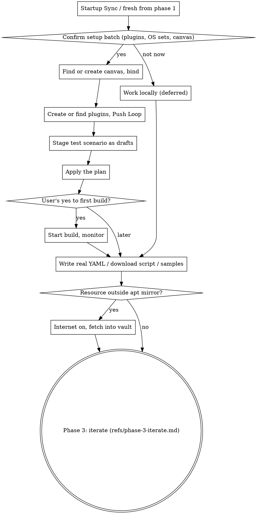

# Phase 2 — Build on the Platform

You connect the project to Rogue Arena, stand up the test bed, and write the first real implementation: Ansible YAML, download script, vault resources, and addon samples. You call the MCP tools yourself (`refs/platform-sync.md` holds the tool-level detail); the user approves the batch once and says yes to each build.

## Checklist

You MUST create a task for each of these items and complete them in order. For an existing project, mark a step done when `project.json` and the platform already show it (IDs saved, `buildStatus` `applied` or `deferred`, a build already up):

1. **Startup Sync** — already done by the router for an existing project; a project fresh from phase 1 needs none
2. **Platform Integration** — one confirmation, then find or create the canvas and the plugins and run the Push Loop
3. **Build test scenario on canvas** — stage drafts (skip if deferred)
4. **Apply the plan and first build** — apply yourself; build on the user's yes; monitor
5. **Write the real implementation** — YAML, download script, addon samples
6. **Fetch offline resources via a test VM** — only when a resource isn't in the apt mirror
7. **Hand to phase 3** — the redeploy that runs the real YAML goes through the Final Check gate

## Process Flow



---

## 1. Platform Integration

Do this by default, first. Every plugin's name, description, type, initial OS compatibility, and params were decided in phase 1, so pushing them now gives every later step a fully synced platform. It is **required** before the test scenario can be staged: canvas plugin assignment needs the `pluginId`, a non-empty YAML body, and the full param schema on the platform.

**Precondition:** metadata is complete (`refs/platform-sync.md` → Startup Sync → Metadata completeness).

### Confirm the setup batch once

Discover tools first: `discover_tools(category: "PLUGIN_DEV")` and `discover_tools(category: "ROGUE_ARCHITECT_BUILDER", subcategory: "plugin_catalog")`. Check whether any plugin or a fitting canvas already exists (`plugin_dev_list`, `architect_canvas_list`), so the message only proposes to create what's missing. Then one message, one yes:

> "Here's what I'll set up:
>  Plugins to create:
>   1. WireGuard Server — application, linux → DebianLinux, Ubuntu, UbuntuGUI, Kali
>   2. WireGuard Client — application, windows → WindowsServer2022, Windows10, Windows11
>  Test canvas: create `wireguard test` (or: use your existing canvas `<name>`)
>  Then I stage the test scenario on it as drafts.
>  Go, or adjust?"

The OS sets follow `refs/platform-sync.md` → Compatible-OS Mapping. Adjust and re-present until the user says go.

### On yes

1. **Canvas** — find, create, and bind it (`refs/platform-sync.md` → Canvas). Bind it first: the template catalog needs a canvas context.
2. **Plugins** — find or create each one (`refs/platform-sync.md` → Plugin IDs), saving `pluginId` and `vaultId` to `project.json` as you go.
3. **Push Loop** — YAML body, compatible templates, params, addon samples for each plugin (`refs/platform-sync.md` → Push Loop).
4. Report: "Pushed name, description, type, initial OS templates, and params for <N> plugin(s). Phase 3 narrows the OS templates once each plugin is built."

### If the user says not now

Work locally: write the YAML and download script (section 4) without platform pushes. Set `testScenario.buildStatus` to `"deferred"`; staging stays blocked until the plugins exist. The next session's Startup Sync backfills everything once they do.

---

## 2. Build Test Scenario on Canvas

> **YOU (the assistant) build this — not the user.** You call the architect MCP tools directly. Do NOT tell the user to run architect-freeform or any other skill. This section is a complete, self-contained build flow executed by you.

Runs when `project.json` has a `testScenario` outline with `buildStatus` `"pending"` and `canvasVersionId` is set. The setup batch confirmation covered staging. A user who declined staging → set `buildStatus` to `"deferred"` and don't ask again in later sessions unless they re-open the topic.

**Hard prerequisite:** every project plugin that will be assigned to a machine MUST have its `pluginId` set in `project.json`, a non-empty YAML body pushed via `plugin_dev_update_yaml` (at least the scaffold placeholder — an empty platform body errors the first build), AND its full param schema pushed via `plugin_dev_add_param`. If any plugin is missing these, finish Platform Integration first. If the user wants to defer that work, set `buildStatus` to `"deferred"` and skip staging — don't half-stage with missing YAML/params.

### Load architect context

Before mutating anything:

1. **Read the architect rules** — `Read` `refs/freeform-context.md` (its constants live in `refs/shared-rules.md`). This covers the Canvas → Domain → VLAN → Machine → Plugin order, DC-first ordering, the **`architect_plugin_catalog_list_full` BEFORE `set_params` LAW**, draft semantics, and account-type separation. **Internalize it before any mutation.** Apply the plan as `refs/platform-sync.md` → Apply the Plan describes.
2. **Discover architect tools** — `discover_tools(category: "ROGUE_ARCHITECT_BUILDER")` (and `subcategory: "deploy"` only when you'll need deploy tools — not needed for staging).
3. **Set the canvas** — `rogue_set_canvas(canvasVersionId)`.
4. **Read current canvas state** — `architect_canvas_get_overview()` so you don't double-create entities already on the canvas.

### Build order

Follow `refs/freeform-context.md`. Staging order, top-down:

1. **Domains** (if any) — `architect_forest_manage` to declare domain topology.
2. **VLANs** — `architect_vlan_add` per VLAN, with the zone from the outline.
3. **Machines** — `architect_machine_add` per machine. Per-VLAN order: DCs first, then servers, then workstations.
4. **Plugins** — for each machine in the outline:
   - Concatenate `platformPlugins` + `projectPlugins`. For project plugins, use the `pluginId` from `project.json`.
   - Call `architect_assigned_plugin_add` to attach each plugin.
   - **Platform catalog plugins:** the catalog entry contains its own verbose configuration instructions — **read the catalog entry and follow those instructions** for any required params; do not invent values. Follow the LAW: `architect_plugin_catalog_list_full` (with the assigned plugin's `pluginId`) BEFORE `architect_assigned_plugin_set_params`, using the discovered field names verbatim.
   - **Project plugins (scaffold-only, no-op placeholder YAML):** give every *required* param a **type-appropriate** placeholder value via `architect_assigned_plugin_set_params` so the first deploy doesn't error on a missing required value. Prefer the param's `defaultValue` from `project.json`; otherwise by type (every value is passed as a **string**, per the tool's `value:string` field) — `string`/`stringBlock` → a marker like `PLACEHOLDER`, `number` → `"0"`, `boolean` → `"false"`, and `csv` → the param's `sampleCSV` (csv values are validated against their headers, so a bare marker fails with `VALIDATION_INVALID_CSV`; the `sampleCSV` already carries valid headers + rows). The no-op YAML ignores these, so the values only need to exist and pass validation, not be correct; set the real values once the plugin is implemented.

Skip realism details that aren't in the outline (user account assignments, file seeding, exploit paths, IP details). The goal is a minimal test bed, not a polished scenario.

After all drafts are staged, set `testScenario.buildStatus` to `"staged"`.

If anything fails mid-build (a catalog plugin not found, a tool error), stop, leave `buildStatus` at `"pending"`, and report what failed so the user can decide whether to retry, edit the outline, or skip.

---

## 3. Apply the Plan and First Build

1. **Apply** — `architect_canvas_apply_plan` (`refs/platform-sync.md` → Apply the Plan). Fix any blocking precheck findings and apply again. On `applied=true`, set `testScenario.buildStatus` to `"applied"`.
2. **Ask for the first build:**
   > "Plan applied on canvas `<name>`: <N> machine(s) across <M> VLAN(s). The project plugins are deploy-safe no-op placeholders, so this first build is a clean infra bring-up with internet OFF (nothing to fetch yet). Start the build now? It provisions <N> VMs; builds usually take 5 to 15 minutes, longer for heavy canvases."
3. **On yes** — `architect_canvas_start_build` (`refs/platform-sync.md` → Builds), then monitor it (`refs/platform-sync.md` → Monitoring In-Flight Builds). Set the habit here on the first build: never sit idle blocking.
4. **Not now** — continue to section 4; you need a live VM only for live discovery or to fetch resources (section 5).

Failures in this first build come from the infrastructure or the platform plugins (the project plugins are no-ops): debug them with phase 3's Live Deployment Debugging (`refs/phase-3-iterate.md`).

---

## 4. Write the Real Implementation

Follow the Ansible KB and SKILL.md's Every Change rules. Replace the scaffold placeholder in each plugin's `ansible_run.yml` with the real task list, and include validation tasks that check the Q3 success criteria (service running, port listening, command output) — phase 3's Anti-Performative Check looks for them. Move the plugin's `status` to `writing-yaml`, update `lastUpdate`, and push the YAML via `plugin_dev_update_yaml`.

Use a live VM from the first build to *discover* the right install flags and paths (`architect_deploy_run_script`, `architect_deploy_read_file`); every finding lands in the YAML (SKILL.md fact 3).

### Download Script Rules

The download script runs on an **online machine** to fetch resources into `for_plugin_vault/`.

**Goes in the download script:**
- Git repository clones
- Chocolatey package downloads
- Offline installer downloads (.msi, .exe, .deb, .tar.gz)
- Docker image saves (`docker save`)

**Does NOT go in the download script:**
- Apt packages (available via local mirror)
- Install logic (belongs in Ansible YAML)
- Configuration files (written inline in YAML or placed in vault manually)

**Format:** `.sh` for Linux resources, `.ps1` for Windows resources.

**Must be idempotent** — safe to re-run if a download was interrupted.

### Addon Config Samples

Some plugins ship a curated library of runtime config files alongside the plugin itself — JSON timelines for Ghosts, XML rules for Sysmon, YAML profiles for Caldera, etc. These are **Addon Config Samples**: named, annotated text blobs stored on the plugin, discoverable through the platform catalog, and consumed by downstream Claude sessions that pick a sample, tweak it in memory, and seed it onto a target machine via the plugin's existing file-seeding parameter (typically a `stringBlock` param).

**Local representation.** Sample bodies are large enough to deserve their own files — don't stuff them into `project.json`. Use this layout:

```
projects/<project>/<plugin>/
  ansible_run.yml
  for_plugin_vault/
  .sample/
    social-media-browsing.json
    developer-workstation.json
    ...
```

`project.json` carries the summary entry (`name`, `notes`, `language`, `sortOrder`, `sampleId` once pushed); `.sample/<name>.<ext>` carries the code body. Keep them in sync — same data split across two files for editor ergonomics.

**Authoring a new sample:**
1. Add an entry to `addonConfigSamples[]` in `project.json` with the next free `sortOrder`.
2. Write the body to `.sample/<name>.<ext>` using the extension matching `language` (`.json`, `.py`, `.yml`, `.ps1`, `.sh`, `.cs`, `.txt`).
3. If `pluginId` is set, call `plugin_dev_add_addon_config_sample` with `pluginId`, `name`, `notes`, `language`, `code` (the body), `sortOrder`. Save the returned `sampleId` back into the matching `project.json` entry.

**Filling in a sample pushed empty from phase 1:** write the body to `.sample/<name>.<ext>`, then `plugin_dev_update_addon_config_sample` with its `sampleId` and the `code`.

**Editing an existing sample:**
1. Update `.sample/<name>.<ext>` and/or the `notes` / `language` / `sortOrder` in `project.json`.
2. Call `plugin_dev_update_addon_config_sample` with `sampleId` plus only the changed fields.

**Deleting samples** (user's yes):
1. Remove entries from `project.json` and delete the matching `.sample/` files.
2. Call `plugin_dev_delete_addon_config_sample` with `sampleIds: [...]`. The platform auto-recompacts `sortOrder` for remaining samples — re-read state via `plugin_dev_get` and align `project.json`.

**Reordering:** edit `sortOrder` on the affected entries in `project.json` and push individual `plugin_dev_update_addon_config_sample` calls with the new `sortOrder` values. The platform owns ordering; local order is informational.

**Sample content rules:**
- Realistic, deploy-ready content — not placeholder. A bad sample is worse than no sample because downstream sessions trust the catalog.
- `notes` is the discovery surface — write it for a future Claude scanning the catalog: *when* to pick this sample, what end state it produces, what params on the consuming machine it assumes.
- Samples are NOT parameters and NOT vault uploads. Installer binaries still go in `for_plugin_vault/` via `plugin_dev_upload_to_vault`; runtime knobs the lab author tunes are still params via `plugin_dev_add_param`.

**Discovery side (for context).** Downstream sessions see `addonConfigSampleCount` on `architect_plugin_catalog_search`, full summaries (no code) on `architect_plugin_catalog_list_full`, and pull the body via `architect_plugin_catalog_get_addon_config_sample(sampleId)`. The plugin must expose a file-seeding param (typically `stringBlock`) for samples to actually land on a target machine — if this plugin ships samples but has no file-seeding param, surface that gap so the user can add one.

---

## 5. Fetching Offline Resources via a Test VM

The goal of every finished plugin is a **fully offline install at deploy time** — no `wget`/`curl` reaching the public internet when the shipped plugin runs. Two sources are allowed at deploy time: the local **apt mirror at `10.1.1.4`** (install Docker, system deps, language runtimes, etc. via Ansible's `apt:` module) and the **plugin vault** (everything else — proprietary installers, container images, git repos, non-apt packages).

### First: does this plugin need internet at all?

Decide from the plugin's resource list (phase 1's research + the `download-resources` script):

- **Everything is available from the apt mirror** → no internet, no vault work. Install via `apt:` against `10.1.1.4` and move on.
- **The plugin needs ANY resource that isn't in the apt mirror** — a proprietary installer (e.g. Splunk, a licensed MSI), a container image, a git repo, a pip/choco/non-mirror package — then that resource has to be **fetched into the vault first, and fetching requires internet ON on a live VM.** Recognize this early and **ask the user to enable internet** on that machine; don't force an offline path for a resource that genuinely isn't local. Enabling internet to build the vault is a required step, not a shortcut.

> **The internet-off rule is about the *shipped* plugin, not the *fetch*.** Internet ON while you pull resources into the vault is correct and expected. What is NOT acceptable is *finishing* a plugin whose deploy still reaches the public internet, or leaving internet on to mask a resource you never vaulted. Final validation always runs internet-OFF on a fresh from-scratch build (phase 3 → Offline Verification).

### 1. Enable internet on the machine(s) that need to fetch

You do NOT need the plugin's YAML finished to fetch — you need a live VM with internet. If the test scenario isn't built yet, bring it up first (sections 2 and 3; its scaffold plugins are deploy-safe no-ops, so that first infra build runs clean with internet off).

The internet setting is a machine setting the user changes in the UI. **Ask the user:**
> "I need internet on `<machine name>` to pull `<X>` into the vault. In Architect, click **Edit** on that machine, expand **Advanced Options**, and flip **'Enable Internet During Architect Build'**. Tell me when it's done and I'll apply the plan."

When they confirm, apply the plan yourself (`architect_canvas_apply_plan`). Then check whether the machine can reach the internet with a quick `architect_deploy_run_script` probe (e.g. a `curl -sI` to the download host). If no build is up, or the probe fails, the setting reaches the VM through a build: start one or preview a redeploy and run it on the user's yes (`refs/platform-sync.md` → Builds).

Internet on those machines is brokered by a separate **InternetProxy VM** that comes online alongside the toggled boxes — not direct cloud egress. The toggle takes effect once that proxy starts. If the proxy is already running and the user re-toggles, existing connectivity stays available.

> **If you run a full redeploy (not just driving an already-up VM) with internet on:** the plugins on those machines must have valid YAML + params first — the no-op scaffold placeholder counts as valid, but broken YAML fails the redeploy regardless of internet. Push YAML/params via `plugin_dev_update_yaml` / `plugin_dev_add_param` and pass the Final Check gate before that redeploy.

### 2. Pull resources on the live VM

Once deployed, use `architect_deploy_*` tools against the build VM:

- `architect_deploy_run_script` — run `apt-get download`, `wget`, `curl`, `docker pull && docker save`, `pip download`, etc.
- `architect_deploy_dir_listing` / `architect_deploy_read_file` — verify what landed.
- `architect_deploy_download_file` — pull the fetched artifacts back to your local workspace under `for_plugin_vault/`. Returns a `transferId`; poll `architect_deploy_transfer_status` every 10-15s.
- `architect_deploy_upload_file` — push helper scripts or test fixtures up to the VM if you need them there mid-flow.

### 3. Upload to plugin vault

Once you have the artifacts locally under `for_plugin_vault/`, use `plugin_dev_upload_to_vault` (TUS resumable; same poll pattern via `plugin_dev_transfer_status`) to push each file into the plugin's vault. Update the YAML to stage them from the vault, push it, and record what was vaulted in `lastUpdate`.

### 4. Turn internet back off

Once every resource is in the vault, you're done with internet. The internet-off proof on a from-scratch build is phase 3's Offline Verification.

---

## 6. Hand to Phase 3

Once the real YAML, vault files, params, and samples are pushed and it's time to run them, load `refs/phase-3-iterate.md`. The redeploy that first runs the real YAML goes through the Pre-Redeploy Final Check Gate (`refs/platform-sync.md`), and the plugin moves to `testing` once builds run against it.
