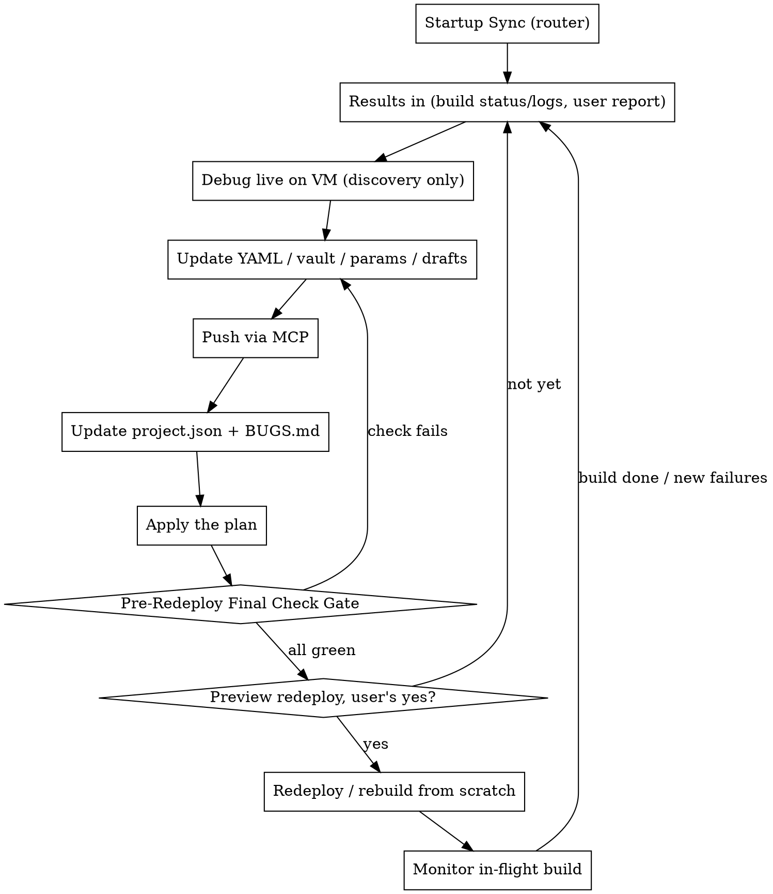

# Phase 3 — Iterate and Update

You run the deploy-debug-fix cycle until every plugin rebuilds clean offline, and you handle later updates to finished plugins. You read build results yourself, debug live on the VM, codify every fix, push it via MCP, apply the plan, and redeploy behind the Final Check gate on the user's go.

**Who does what.** You edit local files, push state via MCP (YAML, params, vault, samples, canvas drafts), apply the plan, read deploy status and logs, and run individual discovery commands on already-deployed VMs via `architect_deploy_*` — that's fix-discovery, not building. Builds, redeploys, and removing a build need the user's explicit yes each time (`refs/platform-sync.md` → Builds). Snapshots / reverts are NOT available through `architect_deploy_*` at all; a clean VM means a from-scratch rebuild.

## Checklist

You MUST create a task for each of these items and complete them in order:

1. **Startup Sync** — done by the router (files, `.sample/` bodies, `BUGS.md`, platform pull and backfill)
2. **Open with the `lastUpdate` follow-up** — check the latest build's status yourself when one may have run
3. **Enter the work loop**

## Process Flow



---

## Work Loop

### 1. Results come in

- A build you started succeeded or failed (you were monitoring it)
- The user reports something: a failure, something not right, the next step, a change of approach, a file to add to the vault
- The user wants to update a finished plugin (new param, new OS, new behavior) — its status drops back to `testing` or `writing-yaml`

### 2. Diagnose

Use Live Deployment Debugging (below). Read the logs yourself rather than asking the user to paste them.

### 3. Update files

Based on the diagnosis, update as needed:
- **`ansible_run.yml`** — add, edit, or remove tasks
- **`for_plugin_vault/`** — add or update files (configs, scripts, templates); a new resource from outside the apt mirror goes through phase 2's Fetching Offline Resources (`refs/phase-2-build.md`)
- **Download script** — add or update download commands
- **Params, metadata, addon samples, canvas drafts** — as the fix requires

### 4. Push via MCP

Every local change goes to the platform in the same step (`refs/platform-sync.md` → Work-Loop Sync).

### 5. Update project.json and BUGS.md

After every change:
- Bump `status` if appropriate (SKILL.md → Status Transitions)
- Write a brief `lastUpdate` note summarizing what changed and what happens next
- Touch `BUGS.md` if this iteration involved bugs (see below):
  - New failure surfaced → add a new entry (`open`)
  - Codified a fix → annotate the entry (`fix applied, awaiting redeploy validation`)
  - Fresh from-scratch redeploy validated a prior fix → delete the entry

### 6. Summarize

Which files changed, what was added/changed/removed, and what happens next (a redeploy, a test, a resource to fetch).

### 7. Redeploy

Apply the plan (`architect_canvas_apply_plan`), pass the Pre-Redeploy Final Check Gate, preview the redeploy, and on the user's yes run it (`refs/platform-sync.md` → Builds). No build exists yet → the first build (`architect_canvas_start_build`), also on the user's yes. Use a resume-from-checkpoint redeploy for fast iteration when the preview offers one; validating a fix or the offline path needs a from-scratch build. Then monitor (`refs/platform-sync.md` → Monitoring In-Flight Builds) and go back to step 1.

---

## Live Deployment Debugging

When `canvasVersionId` is present and a build you started is running or finished, the user says "check the build" or "it's deploying", or reports a deployment issue:

1. Call `discover_tools(category: "ROGUE_ARCHITECT_BUILDER", subcategory: "deploy")` if not already done
2. Set the canvas: `rogue_set_canvas(canvasVersionId)`
3. Follow the LIVEDEPLOY debug workflow:
   - **Start broad:** `architect_deploy_list_status` — overall deployment picture
   - **Triage:** `architect_deploy_list_failed` — which machines/plugins failed
   - **Deep-dive:** `architect_deploy_get_machine_details` (batch up to 10) — get errored plugin ymlIds
   - **Search logs:** `architect_deploy_log_query_raw(ymlId)` with patterns: `fatal:|FAILED!|unreachable`, `msg:|stderr:`, `Exception|Traceback`
   - **Check code:** `architect_deploy_get_ansible_code(ymlId)` — see what was actually executed
4. **Validate live, then codify.** Per the live-shell-as-discovery rule (SKILL.md fact 3), use `architect_deploy_run_script` to test install flags / commands on the build VM and `architect_deploy_read_file` / `architect_deploy_dir_listing` / `architect_deploy_grep_file` to verify state. Iterate live until the command works, then bake it into `ansible_run.yml` — every live finding gets codified. `architect_deploy_run_script` / `architect_deploy_upload_file` / etc. exist to *figure out* the right install flag, config tweak, or file path; never finish a debug session with "I ran the fix on the VM, we're good" — the next redeploy wipes that VM clean and the bug returns. **Snapshot/revert is not available** through `architect_deploy_*`; if a clean VM is needed, that's a from-scratch rebuild on the user's yes. Lean on idempotent Ansible guards (`creates:`, registry checks, `win_package` `state: present`) so the codified run is safe to re-apply against the dirty VM between redeploys.
5. Diagnose the failure, update the YAML/vault files, and push changes via MCP tools

**Silent PowerShell gotcha:** `$ErrorActionPreference = 'Stop'` does NOT catch `.exe` exit code failures. When a Windows plugin fails with "Cannot find service X", look for a silent `.exe` install failure BEFORE the failing line, not at the failing line itself.

### Two-Plugin Debugging

When debugging a multi-plugin project on a canvas:
- Cross-reference both `pluginId` values against deploy tool logs
- Check dependency ordering — server plugin must succeed before client
- If server fails, client failure is likely a cascading symptom — debug server first

### Common Failure Patterns

- Module not found → wrong FQCN (check `ansible.windows.*` vs `community.windows.*`)
- File not found → wrong path or missing copy/download step
- Timeout → increase timeout or check if a reboot task needs longer delay
- Permission denied → check if `become` is actually needed (usually it isn't)
- YAML parse error → check backslash escaping in double-quoted strings
- CSV parsing error → check BOM/carriage return sanitization

---

## `BUGS.md` — Open Bug Board

Every project gets a `BUGS.md` at its root. `lastUpdate` carries the narrative ("changed install command, waiting on build"); `BUGS.md` carries the **open issue board** — what's broken right now. The two are complementary, not redundant.

**Location:** `{ROGUE_WORKSPACE}/plugin-dev/projects/<project>/BUGS.md` (one per project, not per plugin).

**Lifecycle — Claude manages all three transitions:**

1. **Add an entry** the moment a bug is discovered (build log surfaces a failure, live VM inspection reveals a config issue, user reports something wrong). Include:
   - Symptom — what failed, where (machine, plugin, phase)
   - Suspected root cause — best current hypothesis
   - Status: `open`

2. **Annotate the entry** when a fix is applied. Don't delete yet — the fix is unproven until a fresh redeploy validates it. Add:
   - What changed and where (YAML task, vault file, param, canvas setting)
   - Status: `fix applied, awaiting redeploy validation`

3. **Delete the entry** ONLY after a fresh **from-scratch, full-canvas build** validates the fix end-to-end. "It worked when I re-ran the script live" does NOT count, and neither does a redeploy that resumed from a checkpoint — the codified, internet-off, deploy-from-scratch path must succeed (preview strategy `rebuild_from_scratch`, or remove build + start build). Until that happens, the entry stays.

**Format:** loose markdown — one bullet or short block per bug. Don't over-engineer it. Newest entries at the top.

```markdown
# Open Bugs

## [WS1 / wireguard-client] MSI install hangs without /qn
- Symptom: ansible run hangs at "Install WireGuard MSI" task, no progress.
- Suspected: silent install flag missing.
- Status: fix applied, awaiting redeploy validation
- Fix: added `/qn /norestart` to win_package args in ansible_run.yml (2026-05-27)

## [DC1 / ghosts-server] Service not running after install
- Symptom: ghosts.service inactive after plugin reports success.
- Suspected: install puts binary in place but doesn't enable the unit.
- Status: open
```

**Rules:**
- The work loop touches `BUGS.md` on every iteration that involves bugs.
- Empty file (just the heading) = a clean state. That's the goal.
- Never delete an entry to "tidy up" — only redeploy validation justifies removal.

---

## Anti-Performative Check

When a build reports success or the user says "it works", "looks good", "build passed", do NOT just accept it at face value. Before moving the status forward, verify:

- **Does the playbook include validation tasks?** If there are no tasks checking that files exist, services are running, or ports are listening, flag it: *"The build may have passed, but we don't have validation tasks yet. A green build doesn't mean the software is actually working. Let's add checks before calling this done."*
- **Did you read the log?** Pull the plugin's log yourself (`architect_deploy_get_machine_details` → `architect_deploy_log_query_raw`) instead of taking a success report on trust. Surface-level success reports hide silent failures.
- **Is the plugin idempotent?** If it has only run once, recommend a second run to confirm no tasks fail on re-application.

## Red Flags

Common iterate-phase mistakes to watch for and avoid:

| Red Flag | Why It Matters | What To Do |
|----------|---------------|------------|
| Skipping vault file updates | Playbook references a file in `for_plugin_vault/` that doesn't exist or is stale — build will fail with "file not found" | Before summarizing changes, cross-check every `src:` reference against actual vault contents |
| Forgetting `project.json` `lastUpdate` | Next session starts with no context on what happened — the AI and user both lose track | Update `lastUpdate` after every file change, no exceptions |
| Blind-overwriting without reading current state | Destroys work the user or a previous session added — silent data loss | Always read the file before editing. Never write from memory alone |
| Writing playbook headers (`---`, `- hosts:`) | The build system wraps the task list in its own playbook — headers cause parse failures | Task list only. If you catch yourself writing a header, delete it immediately |
| Not testing idempotency | A playbook that only works on a fresh VM is fragile and masks real bugs | After first successful run, always recommend a second run to verify clean re-application |
| Suggesting "redeploy just this one box" | It doesn't exist — every redeploy is canvas-wide and expensive | Batch fixes, pass the Final Check gate, then one redeploy |

---

## Offline Verification

Once every resource is in the vault (phase 2 → Fetching Offline Resources), prove the offline path:

1. **Ask the user** to disable internet on the test machine: in Architect, **Edit** the machine → **Advanced Options** → turn off **'Enable Internet During Architect Build'**, and tell you when it's done.
2. Apply the plan (`architect_canvas_apply_plan`), pass the Final Check gate, and on the user's yes run a **from-scratch** build: a redeploy whose preview strategy is `rebuild_from_scratch`, or remove build + start build (`refs/platform-sync.md` → Builds).
3. Confirm the install completes using only vault-served resources plus the local apt mirror at `10.1.1.4`. If apt/yum reaches out to the **public** internet at any point — or if any `wget`/`curl`/`Invoke-WebRequest` call hits a public host — the plugin isn't done. (Apt traffic to `10.1.1.4` is the success state, not a failure.)
4. Update `project.json` `lastUpdate` with what was vaulted and verified. Move `status` to `done` only after this offline-only verification passes (SKILL.md → Status Transitions).

---

## Post-Build Assessment

After the YAML, params, and vault are stable — but before declaring the plugin done — run this three-step assessment. Each step is a *recommendation*: propose the calls, summarize intent to the user, then proceed.

### 1. Compatible Templates (always run)

Call `plugin_dev_get_compatible_templates` with the current plugin ID. Then narrow the selection based on what the plugin actually does:

- Linux-only (apt/yum/systemd, bash scripts, no PowerShell) → keep only Linux templates (Ubuntu, Debian, Kali, etc.).
- Windows-only / PowerShell → keep only Windows templates (Windows10, Windows11, Windows Server 2022, etc.).
- OS-agnostic (rare) → leave the broad selection.

Always call `plugin_dev_set_compatible_templates` with the narrowed list, using only IDs from this plugin's `availableTemplates` (`refs/platform-sync.md` → Push Loop, get-before-set). Don't ship with the catch-all default.

### 2. Parent Plugin Dependencies (conditional)

Trigger this step when the plugin's params reference something a *different* plugin produces. Heuristics:

- Plugin reads `DomainNameFQDN`, `DomainAdminPassword`, `DomainJoinUser`, etc. → likely depends on a DC-creation plugin. (Lab convention: FQDN-shaped param values must end in `.local`; if a param description doesn't say so, update it via `plugin_dev_update_param`.)
- Plugin connects to a server (Wireguard client → Wireguard server, Elastic agent → Elastic server, AD member → DC, Splunk forwarder → Splunk indexer) → likely depends on the server-side plugin.
- Plugin requires a hostname, IP, or token that another plugin produces.

Workflow:

1. Use `architect_plugin_catalog_search` to find candidates by topic/keyword (e.g., "domain controller", "wireguard").
2. Use `plugin_dev_get` on each candidate to discover its params.
3. Identify the param on the parent that produces the value the child consumes.
4. Call `plugin_dev_create_parent_plugin` with `childMatchParamName` and `parentMatchParamName` set to the matching pair. It declares that this plugin depends on that parent; it does not create a plugin. The backend will auto-link runtime instances when their values match.
5. If no clear parent exists, skip — don't fabricate one.

### 3. Automation Rules (conditional, narrow scope)

Trigger this step **only** when one of these holds:

- **Heavyweight resource plugin** — Elastic, Splunk, Kibana, large databases, Kubernetes, etc. — set `Machine.ramGB` and/or `Machine.cpuCores` literals via `plugin_dev_create_automation`.
- **Plugin produces a domain/hostname/IP** that the VLAN should know about — stamp `VLAN.staticHostMappings` or `VLAN.dnsForwardingTargets` from the param value.
- **Plugin defines the VLAN's identity** (e.g., a DC plugin naming the AD forest) — stamp `VLAN.nickname` from the FQDN param.

Default behavior: **no automations**. Most plugins do not need any. `plugin_dev_create_automation` adds a rule to this plugin; it does not create a plugin.

When you do create one, use the full `AutoUpdateAction` shape:

```json
{
  "targetEntity": "MACHINE",
  "targetField": "ramGB",
  "valueMapping": { "value": 10 },
  "triggers": ["onApply"]
}
```

Or for a param-driven mapping:

```json
{
  "targetEntity": "VLAN",
  "targetField": "nickname",
  "valueMapping": { "value": "${DomainNameFQDN}" },
  "triggers": ["onApply"]
}
```

### Post-Build Assessment Tools

| Tool | When to use |
|------|-------------|
| `plugin_dev_get_compatible_templates` | Before narrowing OS template selection — returns available + currently selected |
| `plugin_dev_set_compatible_templates` | Bulk-replace the compatible templates list |
| `architect_plugin_catalog_search` | Discover candidate parent plugins by keyword/topic |
| `plugin_dev_create_parent_plugin` | Declare this plugin is a child of another plugin (with optional match-param) |
| `plugin_dev_delete_parent_plugin` | Remove a parent-plugin link (user's yes) |
| `plugin_dev_create_automation` | Add an automation rule that stamps VLAN/Machine fields when the plugin runs |
| `plugin_dev_delete_automation` | Remove an automation rule (user's yes; re-read the array first via `plugin_dev_get`) |

---

## Adding Plugins Mid-Development

If the user needs a new plugin in an existing project:

### Single-plugin becoming multi-plugin

1. Create a subfolder named after the existing plugin
2. Move the existing `ansible_run.yml`, `download-resources.*`, and `for_plugin_vault/` into it
3. Create a new subfolder for the new plugin
4. Scaffold the new plugin's files (YAML template, empty vault, empty download script — templates in `refs/phase-1-brainstorm.md` → Scaffold)
5. Update `project.json` — add the new plugin entry with `researching` status

### Already multi-plugin

1. Create the new subfolder
2. Scaffold files
3. Update `project.json`

Then collect its metadata and params (`refs/platform-sync.md` → Startup Sync → Metadata completeness), confirm once, and create it on the platform (`refs/platform-sync.md` → Plugin IDs → Create) before assigning it to any canvas machine.

---

## Archiving

When **all plugins** in a project reach `done` status:

1. Suggest archiving: "All plugins in `<project>` are done. Want to archive it?"
2. Wait for user confirmation — never archive without explicit approval
3. On confirmation:
   - Ensure `{ROGUE_WORKSPACE}/plugin-dev/archived/` exists
   - Move the entire project folder from `projects/` to `archived/`
